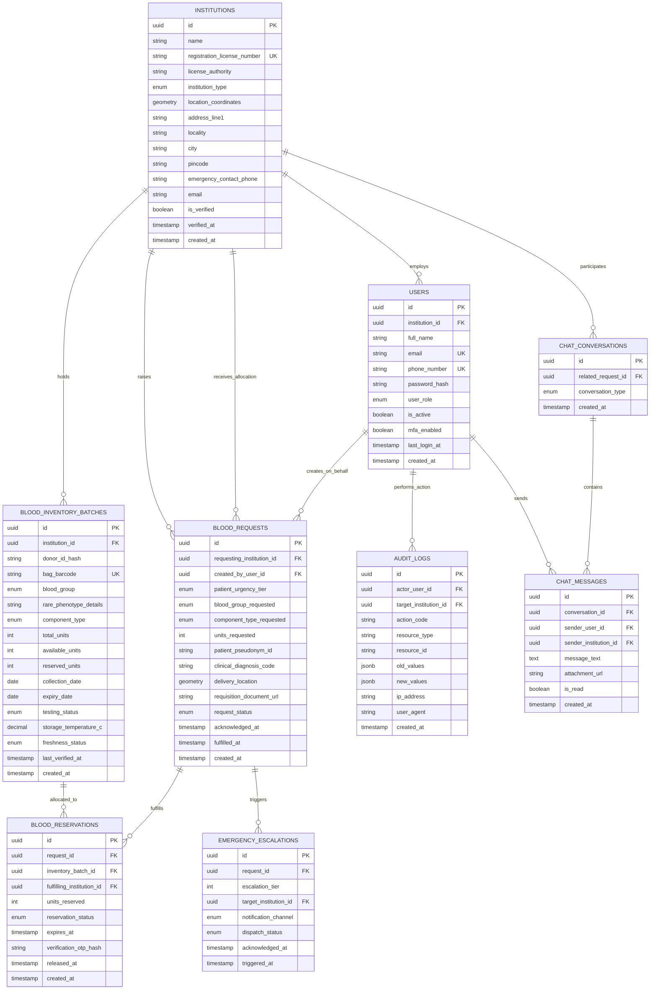

# BloodBridge: Relational Database Schema & Data Modeling

**Document:** `BLOODBRIDGE_DATABASE_DESIGN.md`  
**Date:** November 22, 2026  
**Auditor:** Senior Software Architect, Healthcare Technology Auditor & Full-Stack Engineering Lead  

---

## 1. Database Architecture Overview

The BloodBridge authoritative data store is architected on **PostgreSQL 16** with the **PostGIS** geospatial extension and cryptographic extensions (`pgcrypto`). 

The schema enforces:
1. Strict relational integrity, foreign key cascades, and check constraints to prevent impossible medical states.
2. Microsecond-level spatial lookups via GIST indexes.
3. Row-level concurrency control for blood reservations to guarantee zero double-allocation.
4. An immutable audit ledger logging every state change, access attempt, and inventory modification for legal and regulatory compliance.

---

## 2. Entity-Relationship Diagram (ERD)



---

## 3. SQL Data Definition Language (DDL) Schema

```sql
-- Enable necessary PostgreSQL extensions
CREATE EXTENSION IF NOT EXISTS "uuid-ossp";
CREATE EXTENSION IF NOT EXISTS "postgis";
CREATE EXTENSION IF NOT EXISTS "pgcrypto";

-- ==========================================
-- 1. ENUMERATION TYPES
-- ==========================================
CREATE TYPE institution_type_enum AS ENUM (
    'GOVERNMENT_BLOOD_BANK',
    'PRIVATE_BLOOD_BANK',
    'HOSPITAL_BLOOD_BANK',
    'HOSPITAL_STORAGE_CENTRE',
    'AUTHORIZED_DIAGNOSTIC_LAB'
);

CREATE TYPE blood_group_enum AS ENUM (
    'A_POS', 'A_NEG',
    'B_POS', 'B_NEG',
    'O_POS', 'O_NEG',
    'AB_POS', 'AB_NEG',
    'BOMBAY_OH',
    'OTHER_RARE'
);

CREATE TYPE component_type_enum AS ENUM (
    'WHOLE_BLOOD',
    'PACKED_RED_BLOOD_CELLS',
    'FRESH_FROZEN_PLASMA',
    'PLATELET_CONCENTRATE_RDP',
    'PLATELET_CONCENTRATE_SDP',
    'CRYOPRECIPITATE'
);

CREATE TYPE testing_status_enum AS ENUM (
    'MANDATORY_TESTS_PASSED',
    'PENDING_TESTING',
    'QUARANTINED',
    'REJECTED_DISCARD'
);

CREATE TYPE freshness_status_enum AS ENUM (
    'LIVE_VERIFIED',
    'RECENTLY_UPDATED',
    'STALE',
    'AWAITING_CONFIRMATION',
    'RESERVED',
    'UNAVAILABLE'
);

CREATE TYPE user_role_enum AS ENUM (
    'SUPER_ADMIN',
    'HOSPITAL_MEDICAL_OFFICER',
    'BLOOD_BANK_TECHNICIAN',
    'PATHOLOGIST',
    'PATIENT_ATTENDANT',
    'SYSTEM_AUDITOR'
);

CREATE TYPE urgency_tier_enum AS ENUM (
    'CODE_RED_MASSIVE_HEMORRHAGE',
    'EMERGENCY_SURGERY',
    'URGENT_WITHIN_6_HOURS',
    'ROUTINE_PLANNED'
);

CREATE TYPE request_status_enum AS ENUM (
    'PENDING_MATCH',
    'NOTIFIED_INSTITUTIONS',
    'ACKNOWLEDGED',
    'CROSSMATCHING',
    'DISPATCHED',
    'FULFILLED',
    'CANCELLED',
    'EXPIRED'
);

CREATE TYPE reservation_status_enum AS ENUM (
    'HELD_PROVISIONAL_TTL',
    'CONFIRMED_CROSSMATCHED',
    'RELEASED_FOR_TRANSIT',
    'COMPLETED',
    'CANCELLED',
    'EXPIRED'
);

-- ==========================================
-- 2. CORE INSTITUTIONS TABLE
-- ==========================================
CREATE TABLE institutions (
    id UUID PRIMARY KEY DEFAULT uuid_generate_v4(),
    name VARCHAR(255) NOT NULL,
    registration_license_number VARCHAR(100) NOT NULL UNIQUE,
    license_authority VARCHAR(150) NOT NULL DEFAULT 'Tamil Nadu State Drugs Control / CDSCO',
    institution_type institution_type_enum NOT NULL,
    location_coordinates GEOMETRY(Point, 4326) NOT NULL,
    address_line1 VARCHAR(255) NOT NULL,
    locality VARCHAR(100) NOT NULL, -- e.g. 'Kolathur', 'Anna Nagar', 'Guindy'
    city VARCHAR(100) NOT NULL DEFAULT 'Chennai',
    state VARCHAR(100) NOT NULL DEFAULT 'Tamil Nadu',
    pincode VARCHAR(10) NOT NULL,
    emergency_contact_phone VARCHAR(20) NOT NULL,
    official_email VARCHAR(255) NOT NULL,
    is_verified BOOLEAN NOT NULL DEFAULT FALSE,
    verified_at TIMESTAMPTZ,
    created_at TIMESTAMPTZ NOT NULL DEFAULT NOW(),
    updated_at TIMESTAMPTZ NOT NULL DEFAULT NOW()
);

CREATE INDEX idx_institutions_location ON institutions USING GIST(location_coordinates);
CREATE INDEX idx_institutions_locality ON institutions(locality);

-- ==========================================
-- 3. USERS & CREDENTIALS TABLE
-- ==========================================
CREATE TABLE users (
    id UUID PRIMARY KEY DEFAULT uuid_generate_v4(),
    institution_id UUID REFERENCES institutions(id) ON DELETE SET NULL,
    full_name VARCHAR(150) NOT NULL,
    email VARCHAR(255) NOT NULL UNIQUE,
    phone_number VARCHAR(20) NOT NULL UNIQUE,
    password_hash VARCHAR(255) NOT NULL,
    user_role user_role_enum NOT NULL,
    is_active BOOLEAN NOT NULL DEFAULT TRUE,
    mfa_enabled BOOLEAN NOT NULL DEFAULT FALSE,
    mfa_secret_encrypted VARCHAR(255),
    last_login_at TIMESTAMPTZ,
    created_at TIMESTAMPTZ NOT NULL DEFAULT NOW(),
    updated_at TIMESTAMPTZ NOT NULL DEFAULT NOW()
);

CREATE INDEX idx_users_institution ON users(institution_id);
CREATE INDEX idx_users_email ON users(email);

-- ==========================================
-- 4. BLOOD INVENTORY BATCHES (BAG-LEVEL TRACKING)
-- ==========================================
CREATE TABLE blood_inventory_batches (
    id UUID PRIMARY KEY DEFAULT uuid_generate_v4(),
    institution_id UUID NOT NULL REFERENCES institutions(id) ON DELETE CASCADE,
    donor_id_hash VARCHAR(64) NOT NULL, -- Pseudonymized hash (DPDP compliance)
    bag_barcode VARCHAR(100) NOT NULL UNIQUE, -- ISBT 128 compliant
    blood_group blood_group_enum NOT NULL,
    rare_phenotype_details TEXT, -- e.g., 'Bombay Oh (hh, non-secretor)'
    component_type component_type_enum NOT NULL,
    available_units INT NOT NULL CHECK (available_units >= 0),
    reserved_units INT NOT NULL DEFAULT 0 CHECK (reserved_units >= 0),
    collection_date DATE NOT NULL,
    expiry_date DATE NOT NULL,
    testing_status testing_status_enum NOT NULL DEFAULT 'PENDING_TESTING',
    storage_temperature_c DECIMAL(4,1) NOT NULL,
    freshness_status freshness_status_enum NOT NULL DEFAULT 'LIVE_VERIFIED',
    last_verified_at TIMESTAMPTZ NOT NULL DEFAULT NOW(),
    created_at TIMESTAMPTZ NOT NULL DEFAULT NOW(),
    updated_at TIMESTAMPTZ NOT NULL DEFAULT NOW(),
    CONSTRAINT check_expiration_sanity CHECK (expiry_date >= collection_date)
);

CREATE INDEX idx_inventory_lookup ON blood_inventory_batches(institution_id, blood_group, component_type, available_units);
CREATE INDEX idx_inventory_expiry ON blood_inventory_batches(expiry_date);

-- ==========================================
-- 5. EMERGENCY BLOOD REQUESTS TABLE
-- ==========================================
CREATE TABLE blood_requests (
    id UUID PRIMARY KEY DEFAULT uuid_generate_v4(),
    requesting_institution_id UUID REFERENCES institutions(id) ON DELETE SET NULL,
    created_by_user_id UUID NOT NULL REFERENCES users(id),
    urgency_tier urgency_tier_enum NOT NULL,
    blood_group_requested blood_group_enum NOT NULL,
    component_type_requested component_type_enum NOT NULL,
    units_requested INT NOT NULL CHECK (units_requested > 0),
    patient_pseudonym_id VARCHAR(64) NOT NULL, -- Non-identifiable tracking ID
    clinical_indication VARCHAR(255) NOT NULL,
    delivery_location GEOMETRY(Point, 4326) NOT NULL,
    requisition_document_url VARCHAR(512),
    request_status request_status_enum NOT NULL DEFAULT 'PENDING_MATCH',
    acknowledged_at TIMESTAMPTZ,
    fulfilled_at TIMESTAMPTZ,
    created_at TIMESTAMPTZ NOT NULL DEFAULT NOW(),
    updated_at TIMESTAMPTZ NOT NULL DEFAULT NOW()
);

CREATE INDEX idx_requests_status ON blood_requests(request_status);
CREATE INDEX idx_requests_location ON blood_requests USING GIST(delivery_location);

-- ==========================================
-- 6. ATOMIC BLOOD RESERVATIONS TABLE
-- ==========================================
CREATE TABLE blood_reservations (
    id UUID PRIMARY KEY DEFAULT uuid_generate_v4(),
    request_id UUID NOT NULL REFERENCES blood_requests(id) ON DELETE CASCADE,
    inventory_batch_id UUID NOT NULL REFERENCES blood_inventory_batches(id) ON DELETE RESTRICT,
    fulfilling_institution_id UUID NOT NULL REFERENCES institutions(id) ON DELETE RESTRICT,
    units_reserved INT NOT NULL CHECK (units_reserved > 0),
    reservation_status reservation_status_enum NOT NULL DEFAULT 'HELD_PROVISIONAL_TTL',
    expires_at TIMESTAMPTZ NOT NULL, -- 15-minute TTL hold
    verification_otp_hash VARCHAR(255),
    crossmatch_verified_by_user_id UUID REFERENCES users(id),
    released_at TIMESTAMPTZ,
    created_at TIMESTAMPTZ NOT NULL DEFAULT NOW(),
    updated_at TIMESTAMPTZ NOT NULL DEFAULT NOW()
);

CREATE INDEX idx_reservations_status_expiry ON blood_reservations(reservation_status, expires_at);

-- ==========================================
-- 7. EMERGENCY ESCALATIONS TABLE
-- ==========================================
CREATE TABLE emergency_escalations (
    id UUID PRIMARY KEY DEFAULT uuid_generate_v4(),
    request_id UUID NOT NULL REFERENCES blood_requests(id) ON DELETE CASCADE,
    escalation_tier INT NOT NULL CHECK (escalation_tier BETWEEN 1 AND 4),
    target_institution_id UUID NOT NULL REFERENCES institutions(id),
    notification_channel VARCHAR(50) NOT NULL, -- 'PUSH', 'SMS', 'WHATSAPP', 'IVR'
    dispatch_status VARCHAR(50) NOT NULL DEFAULT 'SENT',
    acknowledged_at TIMESTAMPTZ,
    triggered_at TIMESTAMPTZ NOT NULL DEFAULT NOW()
);

CREATE INDEX idx_escalations_request ON emergency_escalations(request_id);

-- ==========================================
-- 8. IMMUTABLE AUDIT LEDGER TABLE
-- ==========================================
CREATE TABLE audit_logs (
    id UUID PRIMARY KEY DEFAULT uuid_generate_v4(),
    actor_user_id UUID REFERENCES users(id) ON DELETE SET NULL,
    target_institution_id UUID REFERENCES institutions(id) ON DELETE SET NULL,
    action_code VARCHAR(100) NOT NULL, -- e.g. 'UNIT_RESERVED', 'STOCK_DISCARDED'
    resource_type VARCHAR(100) NOT NULL,
    resource_id VARCHAR(100) NOT NULL,
    old_values JSONB,
    new_values JSONB,
    ip_address INET,
    user_agent TEXT,
    created_at TIMESTAMPTZ NOT NULL DEFAULT NOW()
);

CREATE INDEX idx_audit_created ON audit_logs(created_at);
CREATE INDEX idx_audit_resource ON audit_logs(resource_type, resource_id);
```

---

## 4. Freshness Degradation Logic

To satisfy the strict clinical mandate: *"Never treat an old inventory record as confirmed real-time availability"*, the database incorporates an automated freshness degradation schedule:

| Time Since Last Verification | Freshness Status | UI Badge | Clinical Action |
|---|---|---|---|
| $0 \le t \le 60\text{ min}$ | `LIVE_VERIFIED` | Emerald "Live Verified" | Direct emergency reservation allowed. |
| $1\text{ hr} < t \le 6\text{ hrs}$ | `RECENTLY_UPDATED` | Blue "Updated Today" | Reservation triggers immediate SMS verification ping to duty tech. |
| $6\text{ hrs} < t \le 24\text{ hrs}$ | `STALE` | Amber "Stale — Recheck" | Blood bank must re-confirm physical cold-storage counts before reservation lock is accepted. |
| $t > 24\text{ hrs}$ | `AWAITING_CONFIRMATION` | Red "Unverified" | Excluded from direct matching; requires institution physical audit. |
