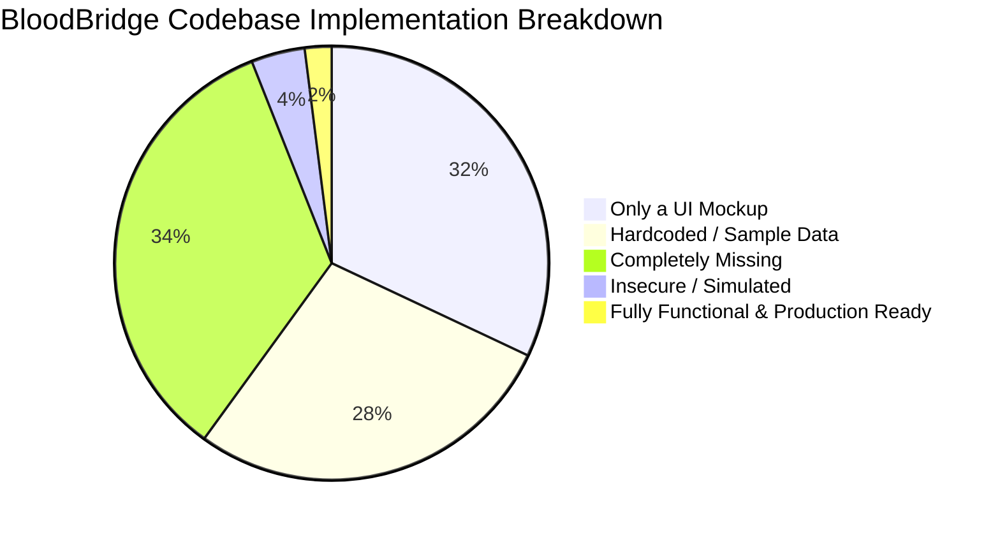

# BloodBridge: Feature-by-Feature Completion Matrix

**Document:** `BLOODBRIDGE_FEATURE_MATRIX.md`  
**Date:** November 22, 2026  
**Auditor:** Senior Software Architect & Healthcare Technology Auditor  

---

## 1. Classification Methodology

To prevent premature claims of completion, every feature is assessed against six strict evaluation criteria:
- **Status 1: Fully implemented & functional** — Code exists, tested, connects to real data/APIs, production-grade.
- **Status 2: Partially implemented** — Functional code exists but lacks edge cases, error recovery, or persistence.
- **Status 3: Only a UI mockup** — Visual interface and interactive elements render, but state is temporary and no backend exists.
- **Status 4: Using hardcoded/sample data** — Data is statically defined in source files or simulated via JavaScript timeouts.
- **Status 5: Completely missing** — Expected by the project vision or README, but has no implementation whatsoever.
- **Status 6: Implemented but insecure or unreliable** — Works superficially, but exposes security flaws or clinical risks.

---

## 2. Granular Feature Matrix

| Feature Area | Specific Capability | Status Classification | Evidence in Codebase | Production Remediation Required |
|---|---|---|---|---|
| **Authentication** | Hospital Email/Password Login | **Status 6: Insecure & Simulated** | `src/services/authService.ts` accepts any credentials, creates fake JWT `jwt_mock_token_`, stores in `localStorage`. | Real password hashing (Argon2id), HttpOnly session cookies, backend authentication gateway. |
| **Authentication** | Multi-Factor Authentication (MFA) | **Status 5: Completely Missing** | No MFA/TOTP/SMS verification exists anywhere in code. | Time-based OTP or SMS OTP gateway for clinical personnel. |
| **Authentication** | Role-Based Access Control (RBAC) | **Status 3: Only a UI Mockup** | Single hardcoded role ("Hospital"). `ProtectedRoute.tsx` only checks `authService.isAuthenticated()`. | Define distinct roles: Hospital Admin, Blood Bank Officer, Lab Tech, Patient Attendant, System Admin. |
| **Authentication** | Password Change & Security Reset | **Status 3: Only a UI Mockup** | `src/pages/Profile.tsx` lines 33-48 manipulates component state and shows toast without persisting. | Secure backend endpoint with current password verification and password policy enforcement. |
| **Dashboard** | Total Available Units KPI | **Status 4: Hardcoded/Sample Data** | `src/data/mockData.ts` and `inventoryService.getStats()` computes sum of static array. | Real-time aggregate count queried from PostgreSQL batch inventory table. |
| **Dashboard** | Partner Banks Count KPI | **Status 4: Hardcoded/Sample Data** | Hardcoded value `12` in `initialStats`. | Dynamic count of active, verified partner institutions in the regional cluster. |
| **Dashboard** | Transfers Today Count KPI | **Status 4: Hardcoded/Sample Data** | Hardcoded value `8` in `initialStats`. | Live aggregation of completed transfer handoffs for current calendar date. |
| **Dashboard** | 3D Blood Drop & Hero Banner | **Status 1: Fully Implemented (Visual)** | `src/components/HeroBanner.tsx` custom SVG with radial gradient and drop shadow. | Production-ready aesthetic component; needs dynamic hospital name binding. |
| **Dashboard** | Expiry Alert Quick View | **Status 4: Hardcoded/Sample Data** | `src/components/ExpiryAlertCard.tsx` renders static item `alt-1` (`O+`, 2 units, 2 days). | Query expiring units (< 5 days) from the user's institution batch database. |
| **Inventory** | 8 Standard ABO/Rh Blood Cards | **Status 1: Fully Implemented (Visual)** | `src/components/BloodCard.tsx` and `src/pages/Inventory.tsx` grid of 8 pastel cards. | Add batch details modal, component separation, and reservation breakdown. |
| **Inventory** | Bombay Blood Group (Oh) | **Status 5: Completely Missing** | Missing from `BloodGroupItem`, `inventoryStock`, and all UI views. | Add Bombay blood group support with specialized pathology handling flags. |
| **Inventory** | Blood Component Tracking | **Status 5: Completely Missing** | Inventory treats all blood as generic units. No distinction of PRBC, FFP, Platelets, Cryo. | Relational component model with specific storage conditions and expiration limits. |
| **Inventory** | Bag-Level DIN / Barcode Tracking | **Status 5: Completely Missing** | No field for Donor Identification Number, bag barcode, or ISBT 128 standard. | Implement barcode scanner integration and individual bag tracking. |
| **Inventory** | Stock Quantity Update Dialog | **Status 4: Hardcoded/Sample Data** | `inventoryService.updateStock` mutates in-memory JavaScript array. Reset on reload. | Backend atomic transaction updating stock with audit log trail. |
| **Inventory** | CSV / Excel Bulk Upload | **Status 3: Only a UI Mockup** | `src/pages/Inventory.tsx` lines 93-100 drag & drop UI executes simulated 800ms promise. | SheetJS/PapaParse backend processing with validation against national registry formats. |
| **Inventory** | Freshness Indicators | **Status 5: Completely Missing** | No indicators for Live Verified, Stale, Awaiting Confirmation, or Expired. | Implement freshness badges with TTL timers based on last physical stock reconciliation. |
| **Search** | Natural Language Query Input | **Status 3: Only a UI Mockup** | `src/pages/Requests.tsx` text box with sample placeholder text. | Add NLP entity extraction pipeline, microphone voice input, and autocompletion. |
| **Search** | Query Classification & Parsing | **Status 4: Hardcoded & Fragile** | `query.match(/\b(A|B|AB|O)[+-]\b/i)` defaults to `B+` if regex fails. Ignores units and location. | LLM / NER pipeline extracting blood group, quantity, locality, and urgency classification. |
| **Search** | Geolocation Proximity Ranking | **Status 4: Hardcoded/Sample Data** | Returns static array of 3 hardcoded hospitals (City General, Apollo, Care) with static distances. | PostGIS spatial queries ranking verified centers by actual road travel time. |
| **Search** | Reserve / Request Blood Button | **Status 3: Only a UI Mockup** | Clicking "Request Blood" updates local state button to "Requested" without backend call. | Distributed reservation transaction locking inventory unit for 15 minutes pending confirmation. |
| **Live Chat** | Inter-Hospital Chat UI | **Status 3: Only a UI Mockup** | `src/pages/Chat.tsx` two-pane layout with responsive message bubbles. | Fully functional UI; requires real WebSocket/SDK transport backend. |
| **Live Chat** | Nexconn SDK Integration | **Status 5: Completely Missing** | Codebase contains `// TODO: integrate Nexconn Chat SDK here`. Package is not installed. | Install genuine Nexconn SDK or implement audited WebSocket protocol with cryptographic verification. |
| **Live Chat** | Message History Persistence | **Status 4: Hardcoded/Sample Data** | Messages stored in `Record<string, ChatMessage[]>` in RAM; re-initialized on refresh. | Store encrypted message threads in PostgreSQL with cursor-based pagination. |
| **Live Chat** | Auto-Reply Simulation | **Status 4: Hardcoded/Sample Data** | `chatService.ts` fires canned auto-reply string after 1000ms delay. | Replace with genuine bidirectional communication between authorized hospital accounts. |
| **Live Chat** | Clinical Document Exchange | **Status 5: Completely Missing** | Chat only supports plain text strings. Cannot attach crossmatch slips or requisitions. | Secure encrypted S3 file upload with anti-malware scanning. |
| **Alerts** | Urgent Expiry Notice List | **Status 4: Hardcoded/Sample Data** | `src/pages/Alerts.tsx` displays 2 hardcoded alerts (`alt-1`, `alt-2`). | Dynamic query of units approaching expiration threshold (PRBC: 3 days, Platelets: 24 hrs). |
| **Alerts** | "Redistribute Now" Action | **Status 3: Only a UI Mockup** | Button opens modal, triggers 700ms timer, displays toast: "broadcast sent to 12 partner blood banks!". | Trigger background broadcast dispatching notifications to nearby hospitals in deficit. |
| **Profile** | Hospital Information Display | **Status 4: Hardcoded/Sample Data** | Displays mock hospital name, license, address, and contact details. | Pull verified profile from institutional database with license verification badge. |
| **Profile** | Edit Profile Modal | **Status 3: Only a UI Mockup** | Saves name and email to component local state only. Lost on navigation. | Authenticated profile update endpoint with validation of administrative credentials. |
| **AI Voice** | Multilingual Voice Search (Tamil/Eng) | **Status 5: Completely Missing** | No audio capture, STT, or speech processing in the repository. | Build Web Audio capture + Whisper / Bhashini STT + Tamil intent recognition. |
| **Emergency** | Multi-Tier Notification Escalation | **Status 5: Completely Missing** | No SMS, push notification, WhatsApp, or IVR escalation logic. | Implement BullMQ worker queue with SMS/WhatsApp/Push escalation state machine. |
| **Attendant** | Patient/Attendant Portal | **Status 5: Completely Missing** | Entire application is geared toward hospital staff; no patient view. | Design and implement mobile-first patient request and tracking portal. |
| **Compliance** | Clinical Crossmatch Disclaimer | **Status 5: Completely Missing** | UI shows direct "Reserve" button without disclaimer that compatibility requires lab crossmatch. | Add mandatory statutory warnings regarding crossmatching and transfusion safety. |
| **Security** | DPDP Act Data Privacy Controls | **Status 5: Completely Missing** | No consent management, no data encryption at rest, no access audit logging. | AES-256 field encryption for health data, immutable audit logs, consent manager. |
| **Testing** | Automated Test Suites | **Status 5: Completely Missing** | Only a visual screenshot Puppeteer script exists. No unit, integration, or E2E tests. | Implement Vitest suite, Playwright E2E flows, and k6 concurrency tests. |

---

## 3. High-Level Summary by Implementation State

- **Fully Functional & Production-Ready**: ~**2%** (Aesthetic CSS design tokens, static SVG components, basic Vite scaffolding).
- **UI Mockup**: ~**32%** (Screens, modals, navigation drawers, layout shells).
- **Hardcoded / Sample Data**: ~**28%** (Mock arrays, setTimeout promises, in-memory state).
- **Completely Missing**: ~**34%** (Backend, DB, real search AI, voice assistant, Nexconn SDK, multi-channel escalation, patient portal, rare blood workflows, tests).
- **Insecure / Simulated**: ~**4%** (Mock JWTs in localStorage, fake password change, unverified blood matching regex).
