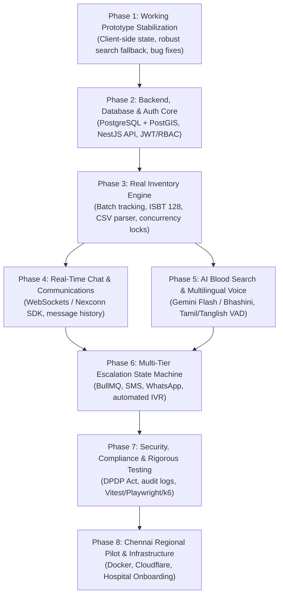

# BloodBridge: Phased Implementation Roadmap

**Document:** `BLOODBRIDGE_IMPLEMENTATION_ROADMAP.md`  
**Date:** November 22, 2026  
**Auditor:** Senior Software Architect, Healthcare Technology Auditor & Full-Stack Engineering Lead  

---

## 1. Roadmap Architecture & Execution Strategy

The transformation of BloodBridge from a high-fidelity frontend mockup into an authoritative, clinically reliable, and secure regional blood coordination platform is structured into **8 distinct, dependency-ordered phases**.

Each phase specifies:
- **Core Objectives & Scope**
- **Hard Dependencies**
- **Acceptance Criteria & Verification Gates**
- **Estimated Effort / Sprint Duration**

---

## 2. Granular Phased Breakdown

### Phase 1: Working Prototype Stabilization (Frontend Functional Polish)
- **Goal**: Make the existing React application genuinely responsive and resilient without breaking current visual mockups.
- **Tasks**:
  1. Fix the silent fallback in `Requests.tsx` to prevent defaulting unmatched queries to `B+`; display clear user warnings if input is ambiguous.
  2. Implement client-side reactive store (Zustand) so inventory updates in `/inventory` dynamically update dashboard KPIs in `/home`.
  3. Wire up `/alerts` "Redistribute Now" action to genuinely decrement near-expiry stock from local state and populate mock transfer logs.
  4. Correct all icon and asset path references; verify production bundle builds cleanly.
- **Dependencies**: Existing repository codebase.
- **Acceptance Criteria**:
  - No silent defaults for blood groups.
  - State changes in one tab immediately reflect in other tabs during the user session.
  - Zero console errors or TypeScript compilation warnings.
- **Estimated Effort**: 1 Sprint (1 week).

---

### Phase 2: Authoritative Backend, Database & Authentication Core
- **Goal**: Establish the authoritative server and persistence layer.
- **Tasks**:
  1. Scaffold Node.js (NestJS / Express + TypeScript) backend service.
  2. Provision PostgreSQL 16 database with PostGIS and pgcrypto extensions.
  3. Execute database migration scripts implementing the full schema (`institutions`, `users`, `blood_inventory_batches`, `blood_requests`, `audit_logs`).
  4. Implement authentication system: password hashing (Argon2id), JWT access tokens, HttpOnly secure cookies, refresh token rotation.
  5. Implement Role-Based Access Control (RBAC) middleware verifying roles (`HOSPITAL_MEDICAL_OFFICER`, `BLOOD_BANK_TECHNICIAN`, `SUPER_ADMIN`).
- **Dependencies**: Phase 1 completion, database hosting.
- **Acceptance Criteria**:
  - Validated login endpoint returning authenticated sessions; unauthenticated requests rejected with `401 Unauthorized`.
  - Passwords stored exclusively as Argon2id hashes.
  - PostGIS geospatial queries functional on test coordinates.
- **Estimated Effort**: 2 Sprints (2 weeks).

---

### Phase 3: Real Inventory Integration & Concurrency Management
- **Goal**: Enable licensed institutions to manage batch-level blood inventory and prevent double-allocations.
- **Tasks**:
  1. Build inventory CRUD endpoints supporting ISBT 128 bag barcodes, components (PRBC, Platelets, FFP), collection dates, and expiry dates.
  2. Implement backend CSV/Excel parser with SheetJS validating uploaded sheets against standard columns with per-row error reporting.
  3. Add Bombay blood group (Oh) and rare phenotype fields to database and UI.
  4. Implement atomic reservation lock using Redis Redlock and PostgreSQL `SELECT ... FOR UPDATE` with a 15-minute provisional TTL hold.
  5. Build automated cron worker degrading inventory freshness from `LIVE_VERIFIED` to `RECENTLY_UPDATED`, `STALE`, and `AWAITING_CONFIRMATION`.
- **Dependencies**: Phase 2 (Backend & Database).
- **Acceptance Criteria**:
  - Concurrent reservation tests with 50 simultaneous workers for 1 remaining unit guarantee exactly 1 successful reservation and 49 conflict rejections.
  - Uploading a 200-row Excel sheet parses and updates batch inventory in $<2$ seconds.
- **Estimated Effort**: 2 Sprints (2 weeks).

---

### Phase 4: Real-Time Chat & Nexconn SDK Integration
- **Goal**: Enable secure, real-time communication between hospital trauma teams and blood banks.
- **Tasks**:
  1. Establish WebSocket server gateway with Redis Pub/Sub backplane.
  2. Integrate the official Nexconn Chat SDK or validated WebSocket medical transport protocol.
  3. Implement channel creation tied directly to active blood reservation IDs.
  4. Add real-time message indicators: Sent, Delivered, Read receipts.
  5. Rebrand all frontend encryption references to reflect actual cryptographic transport guarantees.
- **Dependencies**: Phase 2 (Authentication), Phase 3 (Reservations).
- **Acceptance Criteria**:
  - Two authenticated hospital browsers exchange messages with $<100$ms latency.
  - Disconnecting and reconnecting network automatically resynchronizes missed messages from database history.
- **Estimated Effort**: 1.5 Sprints (1.5 weeks).

---

### Phase 5: AI-Powered Blood Search & Multilingual Voice Assistant
- **Goal**: Allow requesters to search via natural language and speech in Tamil and English.
- **Tasks**:
  1. Implement structured intent-extraction engine (Gemini Flash or fine-tuned NER) extracting `{ blood_group, units, component, locality, urgency }`.
  2. Build conversational clarification loop: if input lacks quantity or group, respond with specific prompts.
  3. Integrate geocoding for Chennai localities (Kolathur, Guindy, Tambaram, Anna Nagar, Adyar) with PostGIS spatial ranking.
  4. Implement Web Audio capture module with client-side Voice Activity Detection (VAD).
  5. Connect speech pipeline to Project Bhashini / Whisper STT supporting Tamil, English, and Tanglish mixed speech.
- **Dependencies**: Phase 2 (Backend), Phase 3 (Inventory).
- **Acceptance Criteria**:
  - Speech input: *"Enakku Kolathur-la O positive blood urgent-ah venum"* correctly extracts `O_POS`, `Kolathur`, `Chennai`, `URGENT`.
  - Incomplete query *"I need blood in Guindy"* triggers clarification: *"Which blood group and how many units do you need?"*.
- **Estimated Effort**: 2 Sprints (2 weeks).

---

### Phase 6: Multi-Tier Emergency Notification & Escalation
- **Goal**: Guarantee life-critical requests are acknowledged via multi-channel escalation.
- **Tasks**:
  1. Implement BullMQ asynchronous queue engine on Redis.
  2. Integrate Gupshup / Twilio SMS and WhatsApp Business API gateways.
  3. Build escalation state machine:
     - T+0m: Dispatch Push & SMS to primary center.
     - T+3m: Dispatch WhatsApp alert to duty officer.
     - T+7m: Trigger automated IVR telephone call to blood bank desk; cascade alert to secondary nearby facilities.
  4. Build acknowledgement tracking dashboard for blood bank operators with 1-click confirmation buttons.
- **Dependencies**: Phase 3 (Reservations), Phase 2 (Backend).
- **Acceptance Criteria**:
  - Simulating an unacknowledged emergency request reliably triggers the tier escalation cascade according to configured timers.
  - Delivery and read receipts logged in `emergency_escalations` table.
- **Estimated Effort**: 1.5 Sprints (1.5 weeks).

---

### Phase 7: Security, Compliance & Rigorous Testing
- **Goal**: Harden system against exploits, satisfy DPDP Act regulations, and achieve high test coverage.
- **Tasks**:
  1. Implement field-level AES-256 encryption for patient medical records and requisition documents.
  2. Add DPDP Act consent notice and purpose-limitation banners on all public request forms.
  3. Implement immutable audit logging table capturing all clinical actions and logins.
  4. Write comprehensive Vitest unit test suite covering inventory models, parsers, and state logic.
  5. Write Playwright end-to-end test scenarios simulating complete request-to-fulfillment lifecycles.
  6. Conduct k6 load and concurrency tests simulating Chennai metropolitan emergency spikes.
- **Dependencies**: Phases 1 through 6.
- **Acceptance Criteria**:
  - Zero critical/high vulnerabilities on static security scan (Snyk/Trivy).
  - Test suite coverage $>85\%$ on critical business logic.
  - Audit logs record all inventory transitions with actor ID and IP address.
- **Estimated Effort**: 2 Sprints (2 weeks).

---

### Phase 8: Chennai Regional Pilot Deployment & Scaled Rollout
- **Goal**: Deploy infrastructure to staging/production and onboard initial Chennai hospital cluster.
- **Tasks**:
  1. Author production multi-stage Dockerfiles and Docker Compose configuration.
  2. Deploy to managed cloud environment (AWS / GCP / DigitalOcean) in Mumbai/Chennai region.
  3. Configure Cloudflare edge with WAF, DDoS protection, and SSL termination.
  4. Establish continuous backup (WAL archiving) and automated disaster recovery drills.
  5. Conduct administrative onboarding and Form 27C/28C license verification for initial 5 pilot blood banks (e.g., in Central/North Chennai).
- **Dependencies**: Phase 7 completion, regulatory/legal clearance.
- **Acceptance Criteria**:
  - Live staging environment operational with 99.9% uptime SLA.
  - Initial 5 pilot facilities successfully syncing live inventory.
- **Estimated Effort**: 2 Sprints (2 weeks).
