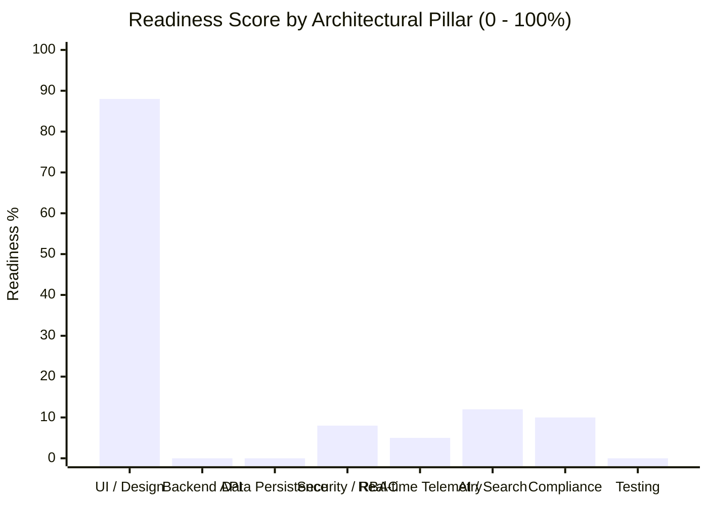

# BloodBridge: Production Readiness Assessment

**Document:** `BLOODBRIDGE_PRODUCTION_READINESS.md`  
**Date:** November 22, 2026  
**Auditor:** Senior Software Architect, Healthcare Technology Auditor & Full-Stack Engineering Lead  

---

## 1. Overall Production Readiness Verdict

```
CURRENT STATUS: NOT PRODUCTION READY (PROTOTYPE STAGE)
OVERALL READINESS SCORE: 12 / 100
READINESS TIER: TIER 0 (FRONTEND UI MOCKUP)
```

The **BloodBridge** application in its current state is a **well-designed, high-fidelity visual prototype**. It excels as an interactive concept demonstration and design specification. However, from a technical, operational, security, and healthcare regulatory standpoint, **it cannot be deployed into a live hospital or blood bank environment without introducing severe clinical, legal, and operational risks**.

---

## 2. Pillar-by-Pillar Readiness Scorecard



| Architectural Pillar | Score (0–100) | Current Status Summary | Major Blocker to Live Deployment |
|---|---|---|---|
| **UI & Visual Design** | **88 / 100** | Exceptional aesthetic consistency, clean Tailwind styling, modern components, Framer Motion animations. | Missing patient/attendant portal views and accessible ARIA live regions for emergency alerts. |
| **Backend & Architecture** | **0 / 100** | Completely missing. No server, no REST/GraphQL API gateway, no business logic tier. | Cannot execute transactions, route requests, or coordinate across institutions. |
| **Data Persistence & Integrity** | **0 / 100** | Simulated via in-memory JavaScript arrays in RAM (`inventory.ts`, `mockData.ts`). | No database, no ACID guarantees, no concurrency locks to prevent double-selling. |
| **Security, Auth & RBAC** | **8 / 100** | Simulated `localStorage` token, zero password hashing, no server-side role enforcement. | Critical vulnerabilities (SEC-01, SEC-02) allow anyone to impersonate a hospital. |
| **Real-time Telemetry & Chat** | **5 / 100** | In-memory message store with fake 1-second `setTimeout` auto-replies. Nexconn SDK is absent. | No WebSocket/WebRTC infrastructure, no message delivery guarantees. |
| **AI Search & Voice** | **12 / 100** | Basic regex fallback defaulting to `B+`, 3 static mock hospitals. No voice STT/TTS. | Cannot parse real clinical requests or rank institutions by actual road travel time. |
| **Legal & Clinical Compliance** | **10 / 100** | Mock license string; no crossmatch warnings, no DPDP Act consent mechanisms. | Facilitating blood transfers without clinical verification creates criminal liability. |
| **Testing & Quality Assurance** | **0 / 100** | Solely a Puppeteer screenshot script. Zero unit, integration, or concurrency tests. | High probability of race conditions during concurrent emergency blood requests. |

---

## 3. Critical Production Blockers (Must-Fix Before Any Live Pilot)

1. **Absence of Concurrency Locks**: In emergency blood management, allocating the same rare unit to two different trauma wards can be fatal. The lack of atomic row-level locking (`SELECT ... FOR UPDATE`) is a non-negotiable blocker.
2. **Insecure Authentication**: The existing `authService` stores plaintext tokens in `localStorage`. There is no verification of institutional credentials against official government drug control registers.
3. **Clinical Safety Safeguards**: The system does not explicitly enforce that blood matching requires physical crossmatching by licensed medical personnel. Erroneously suggesting ABO compatibility guarantees safe transfusion is medically inaccurate.
4. **Absence of Rare Blood Phenotype Rules**: Bombay blood group (Oh) is missing from types and logic. A system that might match O-negative blood to a Bombay blood patient introduces lethal hemolytic risks.
5. **No True Communications Transport**: The Nexconn Chat SDK and WebSocket layers are mocked with timers. Hospitals cannot communicate live during an emergency.
6. **Statutory Non-Compliance (DPDP Act, 2023)**: No consent mechanisms, data encryption at rest, or audit logs for handling personal health data.

---

## 4. Minimum Viable Product (MVP) vs. Full Hospital Deployment Criteria

### 4.1. Hackathon / Technical Demonstration Scope
*Achievable within 3–5 days without compromising codebase integrity:*
- Preserve existing high-fidelity React frontend.
- Implement a lightweight local mock backend (Node.js/Express or Fastify) with SQLite or PostgreSQL Docker container.
- Replace fragile regex with a reliable local NLP entity extractor (e.g., regex + rule-based slot filler) that supports Tamil/English query strings without defaulting to `B+`.
- Implement genuine WebSocket communication between two browser windows (demonstrating live chat and real-time inventory decrement).
- Add clear clinical disclaimers on search results.

### 4.2. Clinical Hospital Pilot Scope (Chennai Cluster)
*Mandatory prerequisites before connecting a single real hospital or blood bank:*
- PostgreSQL 16 + PostGIS database with audited relational schema.
- True atomic reservation locking with 15-minute provisional TTL hold.
- Full institutional onboarding verification (upload and verification of Form 27C/28C licenses issued by Tamil Nadu State Drugs Control).
- Integration of multi-channel emergency escalation (SMS, WhatsApp, and voice IVR fallback).
- End-to-end encryption or TLS 1.3 encrypted WebSocket channels for inter-hospital coordination.
- Comprehensive test suite (Vitest + Playwright + k6 concurrency) passing with $>85\%$ coverage.
- Formal legal and clinical review with a licensed Transfusion Medicine specialist and healthcare regulatory counsel.
