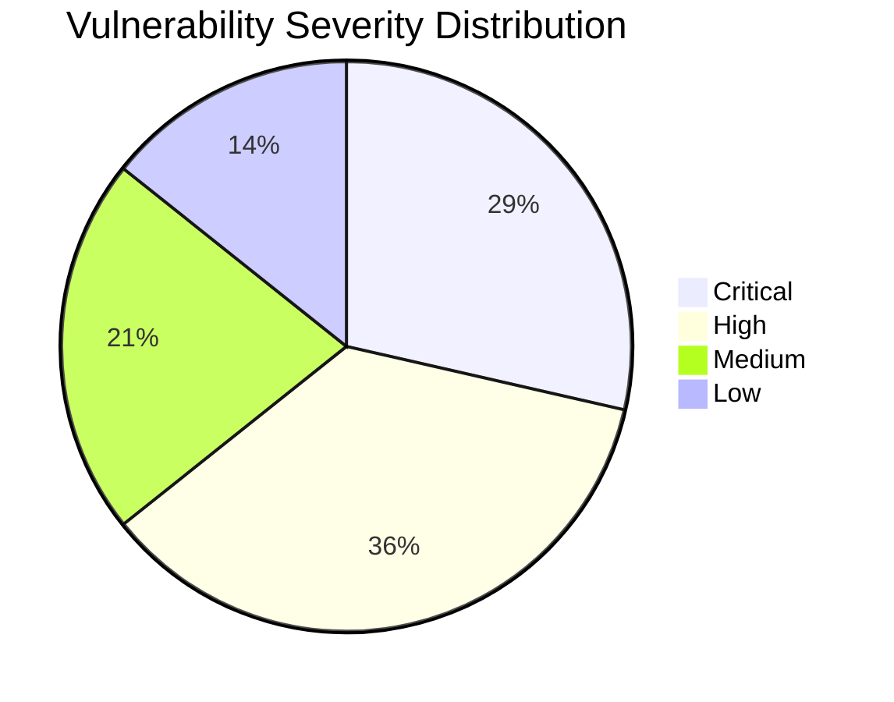

# BloodBridge: Security & Privacy Audit

**Document:** `BLOODBRIDGE_SECURITY_AUDIT.md`  
**Date:** November 22, 2026  
**Auditor:** Senior Software Architect, Healthcare Technology Auditor & Full-Stack Engineering Lead  

---

## 1. Security & Privacy Audit Scope

A rigorous security and privacy evaluation of the BloodBridge codebase was conducted across:
- **Authentication & Credential Storage**
- **Authorization & Access Control Boundaries**
- **Data Privacy & Statutory Healthcare Compliance (DPDP Act 2023, India)**
- **Network, Cryptographic & Session Hygiene**
- **Clinical & Legal Liability Safeguards**

---

## 2. Identified Vulnerabilities & Severity Matrix

| ID | Vulnerability / Gap | Severity | Affected File | Technical Impact & Exploitation Scenario |
|---|---|---|---|---|
| **SEC-01** | Simulated Authentication & Unsigned Mock JWTs | **Critical** | `src/services/authService.ts` | The login endpoint issues a mock token (`'jwt_mock_token_' + Date.now()`). Anyone can inject this token into `localStorage` via console and bypass all route protections. |
| **SEC-02** | Zero Server-Side Access Control (RBAC) | **Critical** | `src/components/ProtectedRoute.tsx` | All application pages rely exclusively on client-side state. An attacker can access inventory adjustments, alert triggers, and profile modifications without server validation. |
| **SEC-03** | False Claim of End-to-End Encryption (E2EE) | **High** | `src/pages/Chat.tsx`, `README.md` | The UI displays an "End-to-end encrypted" lock badge, yet the messages are plaintext strings in client RAM. Misrepresenting cryptographic guarantees in healthcare creates massive legal exposure under consumer and medical regulations. |
| **SEC-04** | Plaintext LocalStorage Token Storage | **High** | `src/services/authService.ts` | Session data is written to `localStorage`. Any Cross-Site Scripting (XSS) vulnerability or malicious browser extension can exfiltrate session credentials. |
| **SEC-05** | Fallback Regex Defaulting to Blood Group B+ | **Critical** | `src/pages/Requests.tsx` | In `handleSearch()`, if regex matching fails, the system quietly defaults `parsedBlood` to `'B+'`. In a medical context, defaulting to an arbitrary blood group can mislead emergency responders. |
| **SEC-06** | Lack of Concurrency Locking on Stock Decrement | **Critical** | `src/services/inventoryService.ts` | The update function merely mutates an in-memory item: `item.units = units`. Under concurrent requests, race conditions will cause double-booking of life-critical units. |
| **SEC-07** | Absence of DPDP Act Compliance & Consent Gates | **High** | Global Frontend | The Digital Personal Data Protection Act, 2023 requires explicit notice and purpose limitation for processing personal healthcare data. BloodBridge currently has no consent architecture. |
| **SEC-08** | Client-Side Password Update Simulation | **Medium** | `src/pages/Profile.tsx` | Changing passwords updates only React state. No current password verification, complexity rules, or server-side hashing (Argon2id/bcrypt) exist. |
| **SEC-09** | Missing Content Security Policy & Security Headers | **Medium** | `index.html` / `vite.config.ts` | No HTTP security headers (`Content-Security-Policy`, `X-Content-Type-Options`, `Strict-Transport-Security`, `X-Frame-Options`) configured. |
| **SEC-10** | Missing File Validation on Bulk Stock Upload | **High** | `src/pages/Inventory.tsx` | The drag-and-drop modal accepts any file and calls `bulkUploadStock()`. In production, lack of file type (MIME), size limits, and antivirus scanning will enable malicious file execution. |
| **SEC-11** | Public Exposure Risk for Patient Healthcare Requisitions | **High** | Architecture / Vision | If patient requisition slips (containing doctor notes, patient diagnosis, Aadhaar) are stored in public S3 buckets, medical confidentiality is breached. |
| **SEC-12** | Missing Audit Logging for Stock Modifications | **Medium** | `src/services/inventoryService.ts` | Modifying inventory leaves zero audit record of user ID, timestamp, prior units, or justification. |
| **SEC-13** | Lack of Rate Limiting on Search & Reservation | **Medium** | Global Architecture | Without rate limiting, malicious bots can scrape institutional inventory or flood fake reservation requests to exhaust regional supplies. |
| **SEC-14** | Absence of Mandatory Clinical Crossmatch Disclaimer | **Low** | `src/pages/Requests.tsx` | The search UI offers a direct "Request Blood" button without warning that compatibility must be verified by laboratory crossmatch before release. |

---

## 3. Deep-Dive Compliance Analysis

### 3.1. Indian Digital Personal Data Protection Act, 2023 (DPDP Act)
The DPDP Act governs the processing of digital personal data within India. In the context of BloodBridge:
- **Data Fiduciary Responsibility**: BloodBridge acts as a Data Fiduciary when collecting patient, attendant, or donor data.
- **Notice & Consent (Section 5 & 6)**: Before a patient or attendant uploads a prescription or requests blood, an itemized notice in English and Tamil must explain what data is collected, the specific purpose (blood unit discovery and reservation), and how long it will be retained.
- **Data Minimization (Section 6(1))**: The public search index must **never** index patient names, phone numbers, or diagnostic details. Inter-institutional coordination must strictly use **pseudonymized request IDs** (e.g., `REQ-CHN-2026-8812`).
- **Security Safeguards (Section 8(5))**: Mandatory implementation of technical safeguards including encryption at rest (AES-256) and in transit (TLS 1.3), role-based access control, and periodic vulnerability assessments. Failure to implement reasonable security safeguards carries penalties up to ₹250 Crores.

### 3.2. Drugs and Cosmetics Act, 1940 & Blood Banking Regulations (Part X-B)
- **Prohibition of Commercial Blood Trading**: The Supreme Court of India banned paid blood donors in 1996. BloodBridge must never function as a commercial marketplace or facilitate monetary bidding/auctions for blood units.
- **Mandatory Institutional Licensing**: Blood units can only be collected, stored, and issued by institutions holding valid Form 27C / 28C licenses issued by the State Drugs Controller / CDSCO. Every participating institution on BloodBridge must undergo manual administrative KYC verification against official registries before publishing stock.
- **Mandatory Pre-Transfusion Testing**: Under Schedule F, Part XII-B, all human blood units must test negative for HIV I & II, Hepatitis B (HBsAg), Hepatitis C (HCV), Syphilis (VDRL), and Malaria parasites. The system must never mark a unit as `AVAILABLE` if its mandatory testing status is unconfirmed.

---

## 4. Technical Security Remediation Checklist

- [ ] **SEC-REM-01**: Replace mock authentication with backend JWT/OIDC service, issuing tokens with 15-minute expiration and HttpOnly refresh cookies.
- [ ] **SEC-REM-02**: Implement Argon2id password hashing with minimum 12-character complexity enforcement and rate-limited login endpoints.
- [ ] **SEC-REM-03**: Enforce Role-Based Access Control (RBAC) at the backend API gateway for every route.
- [ ] **SEC-REM-04**: Either integrate true client-side cryptographic key exchange (Signal/Olm protocol) or remove all "End-to-end encrypted" claims, rebranding to "Secure encrypted TLS channel".
- [ ] **SEC-REM-05**: Implement Redis distributed locks and PostgreSQL `SELECT ... FOR UPDATE` row locks on inventory allocations.
- [ ] **SEC-REM-06**: Configure strict HTTP security headers via Nginx/Cloudflare (CSP, HSTS, X-Frame-Options, X-Content-Type-Options).
- [ ] **SEC-REM-07**: Restrict file uploads to `.csv`, `.xlsx`, and `.pdf` with strict magic-byte validation, 5MB file caps, and ClamAV antivirus scanning in S3 buckets with private access policies.
- [ ] **SEC-REM-08**: Pseudonymize all patient records, stripping identifying data from inter-hospital broadcast logs.
- [ ] **SEC-REM-09**: Implement an append-only `audit_logs` table recording all inventory modifications, user logins, and emergency dispatches.
- [ ] **SEC-REM-10**: Insert mandatory statutory medical disclaimers on all search and reservation screens regarding crossmatching and licensed clinical release.
