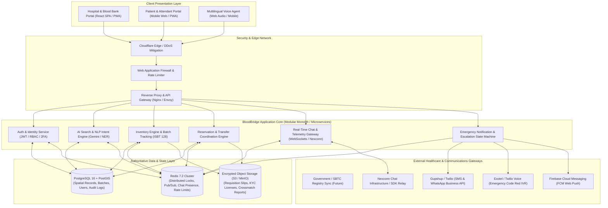

# BloodBridge: Recommended Production Architecture

**Document:** `BLOODBRIDGE_SYSTEM_ARCHITECTURE.md`  
**Date:** November 22, 2026  
**Auditor:** Senior Software Architect, Healthcare Technology Auditor & Full-Stack Engineering Lead  

---

## 1. Architectural Philosophy & Design Principles

BloodBridge is a mission-critical healthcare application designed to operate in high-stress clinical emergency environments across Chennai, Tamil Nadu. The architectural decisions are governed by five inviolable principles:

1. **Safety & Clinical Integrity First**: The software must never promise what cannot be verified. It acts as an authoritative coordinator, strictly acknowledging that clinical crossmatching, screening, and transfusion compatibility remain the exclusive purview of licensed medical officers.
2. **Zero Overselling / Concurrency Safety**: In acute trauma emergencies, multiple hospitals may compete for the same scarce unit (e.g., O-negative or Bombay phenotype). The system must employ distributed locking and atomic ACID transactions to guarantee a unit cannot be double-reserved.
3. **Graceful Degradation & Network Resilience**: Chennai medical centers range from state-of-the-art corporate facilities to congested government taluk hospitals with variable mobile bandwidth. The platform must support offline queueing, low-bandwidth fallback (SMS/USSD), and progressive web app capabilities.
4. **Data Sovereignty & Regulatory Compliance**: Adherence to the Digital Personal Data Protection Act, 2023 (DPDP Act, India), the Drugs and Cosmetics Act, 1940 & Rules, 1945, and National Blood Transfusion Council (NBTC) guidelines. Patient identifiers must never be exposed publicly.
5. **Pragmatic Scalability without Overengineering**: Avoid unnecessary microservice fragmentation during early pilot phases. A modular monolith or lightweight event-driven core is adopted, backed by managed PostgreSQL, Redis, and message queues.

---

## 2. High-Level System Architecture Diagram



---

## 3. Subsystem Breakdown & Technical Specifications

### 3.1. Client Presentation Layer
- **Hospital / Blood Bank Portal**: Modernized from the existing React 18 + Vite + Tailwind CSS repository. Features role-specific dashboards for Medical Officers, Laboratory Technicians, and Inventory Clerks.
- **Patient & Attendant Portal**: Lightweight, responsive mobile web application requiring minimal bandwidth. Focuses on:
  - Emergency blood request submission.
  - Upload of hospital requisition slip.
  - Transparent real-time status progression.
- **AI Voice Interface**: Embedded Web Audio recorder with client-side voice activity detection (VAD). Streams audio chunks to backend transcription service for hands-free emergency queries in Tamil and English.

### 3.2. API Gateway & Security Edge
- **TLS 1.3 Termination & HSTS**: Strict transport security with mandatory encryption in transit.
- **Adaptive Rate Limiting**: Redis-backed token bucket algorithm limiting anonymous public searches (preventing commercial scrapers and data harvesting), with high-priority bypass for verified emergency hospital credentials.
- **Content Security Policy (CSP)**: Strict headers preventing cross-site scripting (XSS) and unauthorized iframe embedding.

### 3.3. Core Backend Services

#### A. Auth & RBAC Service
- Issue short-lived cryptographically signed JWT access tokens (15 minutes) paired with HttpOnly, Secure, SameSite=Strict refresh cookies (7 days).
- Role-Based Access Control enforcing least privilege:
  - `SUPER_ADMIN`: Platform governance and institutional KYC verification.
  - `HOSPITAL_OFFICER`: Doctor or clinical administrator authorized to initiate emergency transfers.
  - `BLOOD_BANK_TECH`: Technician authorized to update bag-level inventory, record crossmatch results, and log dispatches.
  - `PATIENT_ATTENDANT`: Verified public user requesting blood on behalf of a patient with medical prescription.
- Mandatory Multi-Factor Authentication (SMS OTP / TOTP) required for confirming blood dispatch or changing hospital contact details.

#### B. AI Natural Language Search & Discovery Engine
- Two-tier parsing architecture:
  1. **Deterministic Fast Path**: Specialized regex and token normalizer matching standard ABO/Rh combinations and common Chennai locality tokens.
  2. **Neural Parsing Path**: Lightweight LLM / NER pipeline (Gemini Flash or local spaCy/HuggingFace model) capable of understanding Tamil, English, and Tanglish queries:
     - Extraction schema: `{ blood_group: string, units: number, locality: string, urgency: 'EMERGENCY' | 'URGENT' | 'ROUTINE', component_type: 'PRBC' | 'PLATELETS' | 'FFP' }`.
     - Explicit validation check: If quantity or blood group is ambiguous, the system enters a clarifying dialogue rather than guessing.
- Spatial Ranking: Coordinates of the request location are resolved via Chennai locality gazetteer and queried against PostGIS:
  $$\text{Score} = w_1 \cdot \text{ProximityScore} + w_2 \cdot \text{FreshnessScore} + w_3 \cdot \text{StockDepthScore} - w_4 \cdot \text{TransitPenalty}$$

#### C. Inventory & Batch Management Engine
- Compliant with national ISBT 128 / DIN standards.
- Blood is categorized by distinct components: Whole Blood, Packed Red Blood Cells (PRBC), Platelet Concentrate (RDP/SDP), Fresh Frozen Plasma (FFP), and Cryoprecipitate.
- Cold-Chain Monitoring: Mandatory storage temperature validation upon stock update.
- Expiration Watchdog: Automated daily cron jobs tagging batches approaching expiry and triggering redistribution recommendations.

#### D. Concurrency & Reservation Engine
- Prevents double-allocation using Redis Redlock / distributed locks combined with PostgreSQL row-level locks (`SELECT ... FOR UPDATE`):
  ```sql
  BEGIN;
  SELECT id, available_units, reserved_units 
  FROM blood_inventory 
  WHERE institution_id = $1 AND blood_group = $2 AND status = 'AVAILABLE' 
  FOR UPDATE;
  -- Validate quantity >= requested_units
  UPDATE blood_inventory 
  SET available_units = available_units - $3, 
      reserved_units = reserved_units + $3 
  WHERE id = $4;
  INSERT INTO blood_reservations (...);
  COMMIT;
  ```
- **Time-to-Live (TTL) Ephemeral Hold**: Units are placed on a 15-minute provisional hold. If the requesting hospital or patient fails to provide an authorized requisition slip or the blood bank rejects the transfer, the hold expires automatically and the units revert to `AVAILABLE` status.

#### E. Emergency Notification & Escalation State Machine
- Asynchronous event-driven worker (BullMQ + Redis):
  - **T+0 min**: Emergency request logged. Push notification + SMS dispatched to primary matched blood bank.
  - **T+3 min**: If unacknowledged, automated WhatsApp notification sent to on-duty technician.
  - **T+7 min**: If still unacknowledged, request cascades to Tier-2 nearby backup facilities and triggers automated IVR voice call to blood bank duty desk.
  - **T+12 min**: Request escalates to regional Chennai Blood Transfusion Council emergency nodal desk.
  - **Terminal State**: Request fulfilled, cancelled by doctor, or transferred to alternate provider.

#### F. Real-Time Chat & Nexconn Integration
- WebSockets transport with Redis Pub/Sub channel multiplexing.
- Authenticated channels strictly restricted to participants of an active reservation (Requesting Hospital Medical Team $\leftrightarrow$ Fulfilling Blood Bank Pathology Team).
- Integration with Nexconn SDK for inter-institutional secure messaging, read receipts, and clinical presence detection.

---

## 4. Scalability & High Availability for Chennai Metropolitan Area

### 4.1. Traffic & Data Volume Sizing (Chennai Urban Region)
- Licensed Blood Banks & Storage Centers in Chennai: ~85 institutions.
- Major Hospitals & Emergency Trauma Centers: ~120 facilities.
- Active Blood Batches in circulation: ~15,000–25,000 units at any given time.
- Daily Emergency Requests: ~300–500 regional requests/day.
- Peak Concurrency: ~50 simultaneous requests during severe incidents/monsoon trauma spikes.

### 4.2. Database & Cache Sizing
- PostgreSQL: Primary database with streaming replica. 4 vCPU, 16 GB RAM is sufficient to handle 2,000 read queries/sec and 200 ACID transaction updates/sec.
- PostGIS spatial index (`GIST(location)`) evaluates proximity across 200 institutions in $<2$ milliseconds.
- Redis Cluster: 2 nodes (1 primary, 1 replica) with 4 GB RAM managing distributed locks, WebSockets state, and session tokens.

### 4.3. Disaster Recovery & Backup Plan
- Continuous Write-Ahead Logging (WAL) archiving to encrypted S3-compatible storage.
- Point-in-time recovery (PITR) capable of restoring database state to within 60 seconds of any failure.
- Daily automated snapshot backups with automated health verification and cold restore drills.
